

  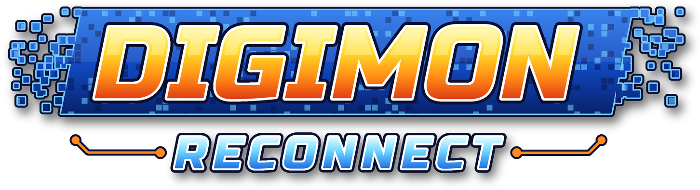

<h1 align="center">Digimon World 3: Reconnect</h1>

<b>O Digimon World 3 de volta, com visual renovado, centenas de Digimon novos e modo online para jogar com os amigos.</b>

---

**Digimon World 3: Reconnect** é um remake de fã do Digimon World 3, feito por fã e para fãs. A história, os mapas, as batalhas e o Card Battle são os do jogo original, agora com gráficos reformulados, mais conteúdo, uma interface moderna e a possibilidade de encontrar outros Tamers pelo mundo.

É um projeto sem fins comerciais. Quem vai jogar recebe o jogo pronto: é só abrir e jogar.

## Sumário

- [Capturas](#capturas)
- [O que há de novo](#o-que-há-de-novo)
- [Modelos reformulados](#modelos-reformulados)
- [Controles](#controles)
- [Aviso](#aviso)

## Capturas

| | |
| --- | --- |
| 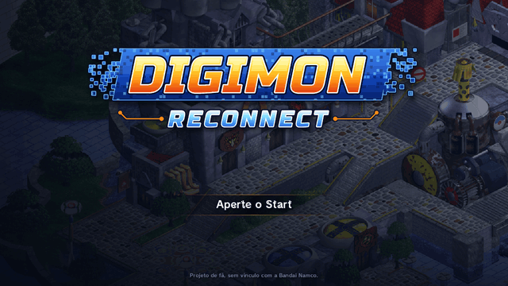 | 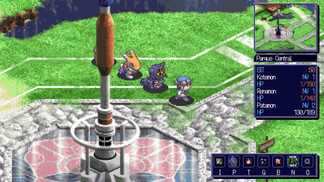 |
| **Tela de título** com três slots de save e o modo online. | **Exploração** com os parceiros seguindo o Tamer, minimapa e barra de atalhos. |
| 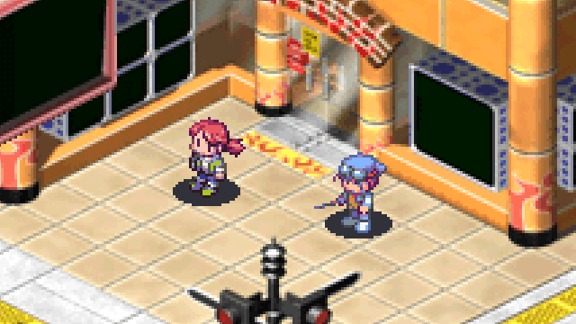 | 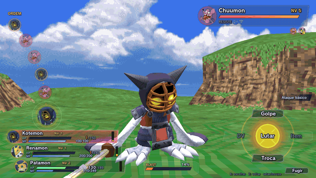 |
| **Seu nome na história:** os personagens chamam você pelo nome que você escolheu. | **Batalhas** com os novos modelos, animações e efeitos de técnica. |
| 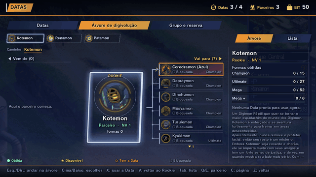 | 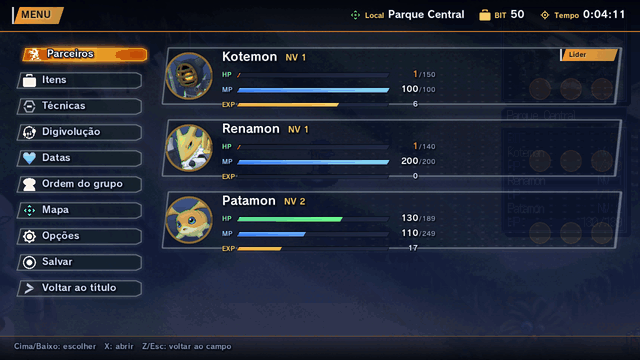 |
| **Árvore de digivolução** de cada parceiro, para planejar as próximas formas. | **Menu** renovado, com atributos, resistências, digivoluções e equipamentos. |

## O que há de novo

### Visual renovado
- **Modelos 3D reformulados** para os Digimon, com animações novas e mais detalhadas.
- **Efeitos de técnica novos**, com brilho, explosões e ondas de energia.
- **Batalhas a 60 quadros por segundo**, bem mais fluidas que no original.
- **Ciclo de dia e noite** nas áreas abertas: amanhecer, dia, entardecer e noite, com o relógio na tela. No online, todos os jogadores veem a mesma hora.
- **Interface de batalha e menus modernos**, com o mapa e a exploração mantendo a cara do Digimon World 3.
- Opção de **cel-shading** para quem prefere um visual de desenho animado.

### Muito mais Digimon
- **Centenas de Digimon novos:** mais de 370 novos inimigos espalhados pelas regiões do mundo, ao lado dos Digimon originais, cada um no nível certo para a área, e mais de 600 espécies no total entre inimigos e formas de digivolução.
- **Datas:** os Digimon derrotados podem deixar a sua **Data**. Use uma Data num parceiro para liberar aquela forma na árvore de digivolução dele.
- **Árvores de digivolução muito maiores:** cada parceiro tem dezenas de formas possíveis (Champion, Ultimate, Mega e além), com uma tela que mostra de onde cada forma vem e para onde ela pode ir.
- **Novos parceiros:** a Data de um Rookie que você ainda não tem traz um parceiro novo para o seu time.
- **Reserva de parceiros:** leve três na equipe e guarde os outros para trocar quando quiser.
- O sistema de digivolução do Digimon World 3 continua o mesmo: níveis de DV, três formas equipadas, técnicas compartilhadas e o Blast.

### Online
- **Jogue com os amigos:** entre num servidor e veja os outros Tamers andando pelos mesmos mapas, cada um com o seu nome.
- **Chat** no próprio jogo, com o mapa atual ou com todo mundo.
- O progresso do personagem online fica guardado no servidor.

### Mais conforto para jogar
- **Três slots de save**, com resumo de cada um (lugar, parceiros, tempo de jogo).
- **Salve quando quiser** pelo menu de pausa, e o jogo também salva sozinho depois de cada batalha.
- **Minimapa** com o nome do lugar, no canto da tela.
- **Barra de atalhos** no estilo de MMORPG para abrir itens, parceiros, técnicas, digivoluções, Datas, mapa e opções com uma tecla.
- **Entrar nos lugares só de andar** até a saída, sem precisar apertar botão.
- **Mensagens de batalha que passam sozinhas** e turno do inimigo automático.
- **Seu nome na história:** os personagens usam o nome que você escolheu.
- **Controle (gamepad)** e **mouse** em todos os menus, tela cheia e zoom do mapa.
- **Totalmente em português do Brasil**, com opção de inglês.

### O jogo original inteiro
- A história do Digimon World 3 do começo ao fim, até o final e os créditos, com os mapas, cidades, NPCs, lojas, pousadas, o Digimon Lab e os leilões.
- **Academias** com a animação de treino do original.
- **Card Battle** completo e animado, com todas as cartas, os decks dos oponentes, o álbum de cartas e o editor de pastas.
- **Apelidos** para os seus Digimon.

## Modelos reformulados

À esquerda, o modelo original do PlayStation; à direita, o modelo do Reconnect, na mesma pose e no mesmo golpe.

| | | |
| --- | --- | --- |
| 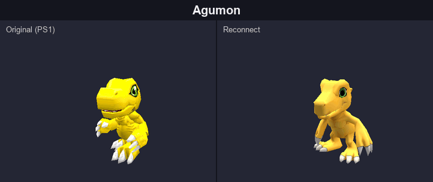 | 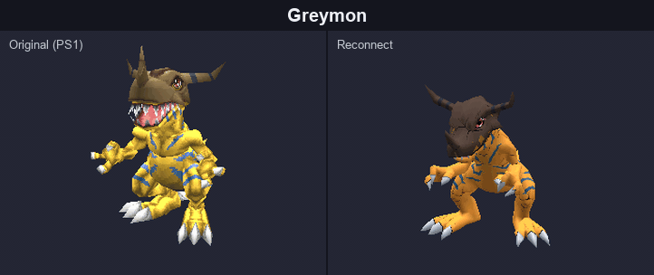 | 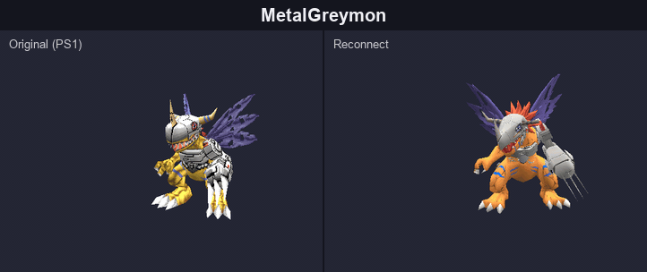 |
| 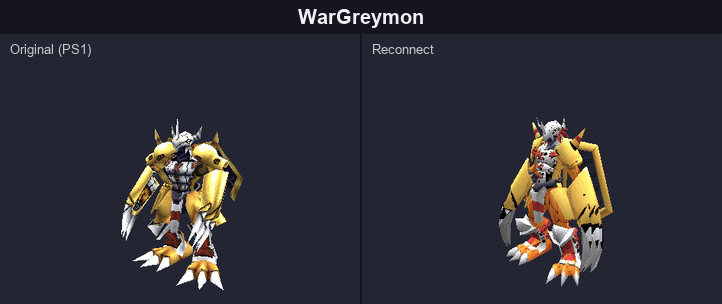 | 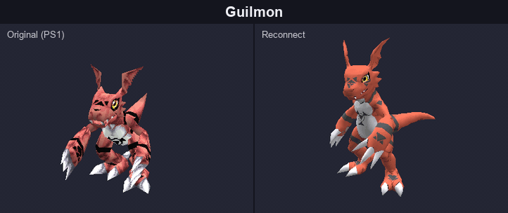 | 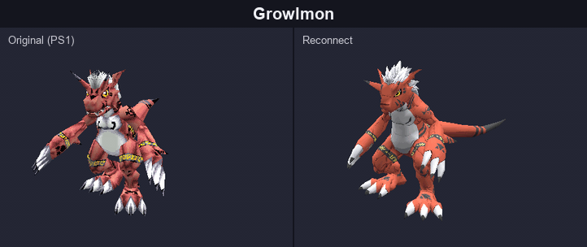 |
| 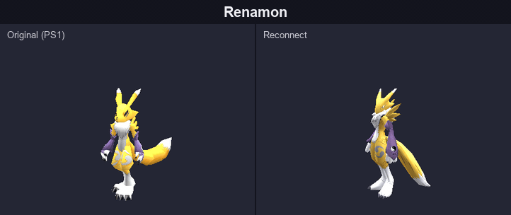 | 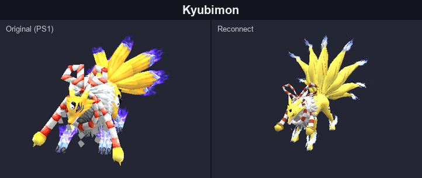 | 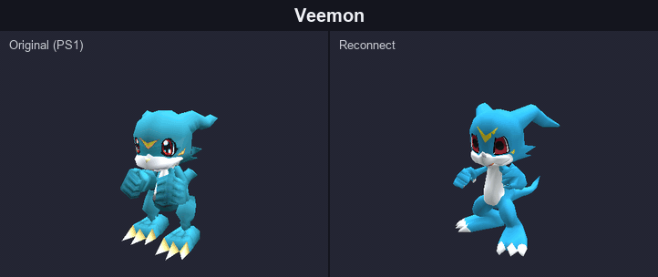 |
| 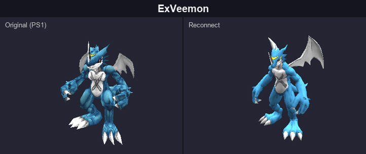 | 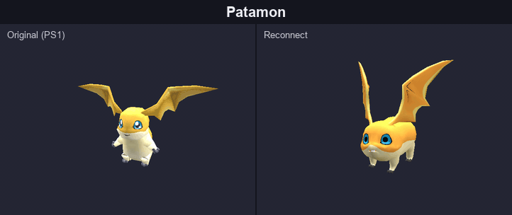 | 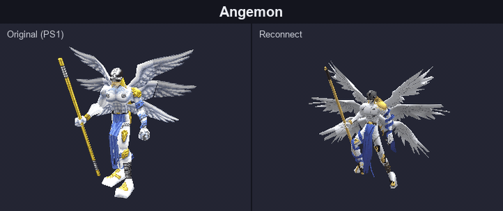 |

Todos os pares numa imagem só

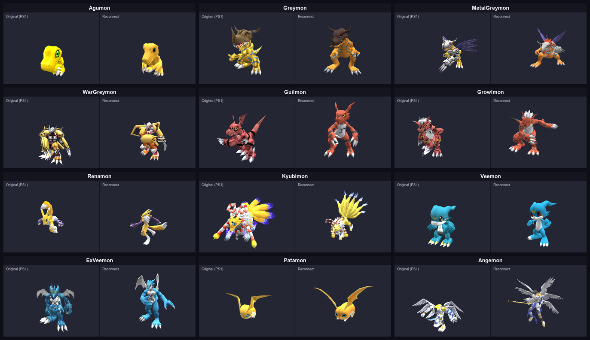

## Controles

| Onde | Teclado | Controle |
| --- | --- | --- |
| Andar | setas ou WASD (Shift anda devagar) | direcional ou analógico |
| Falar, confirmar | X, Espaço ou Enter | A / Cruz |
| Voltar | Z ou Esc | B / Círculo |
| Menu de pausa | Tab ou Esc | Y / Triângulo |
| Atalhos | I itens, P parceiros, T técnicas, G digivolução, B Datas, N mapa, O opções | — |
| Minimapa | M liga e desliga | — |
| Chat (online) | Enter abre, Esc fecha | — |
| Zoom do mapa | + e − | — |

Os menus também funcionam com o mouse: passe por cima para escolher e clique para confirmar.

## Aviso

Digimon World 3: Reconnect é um projeto de fã, gratuito e sem fins comerciais. Não tem nenhuma ligação com a Bandai Namco. Digimon e Digimon World são marcas dos seus respectivos donos.
